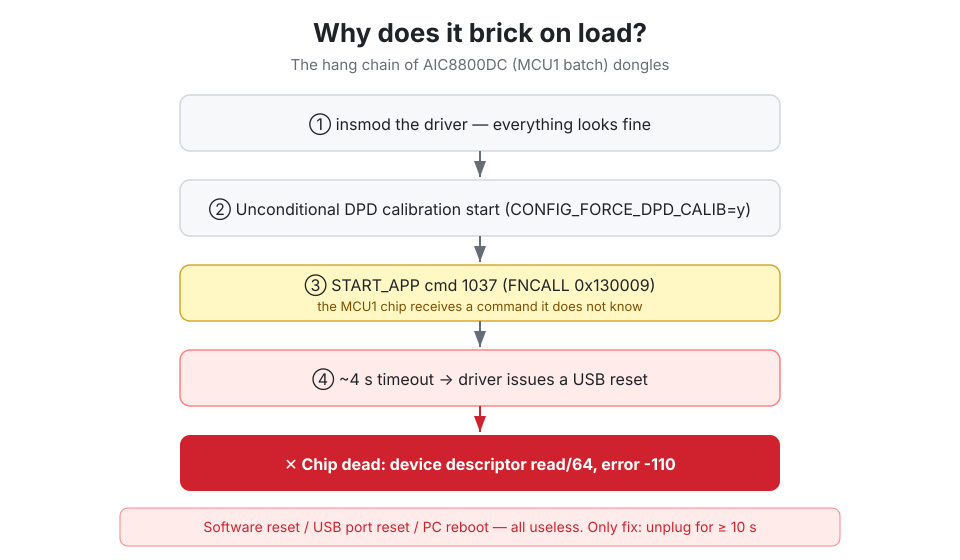
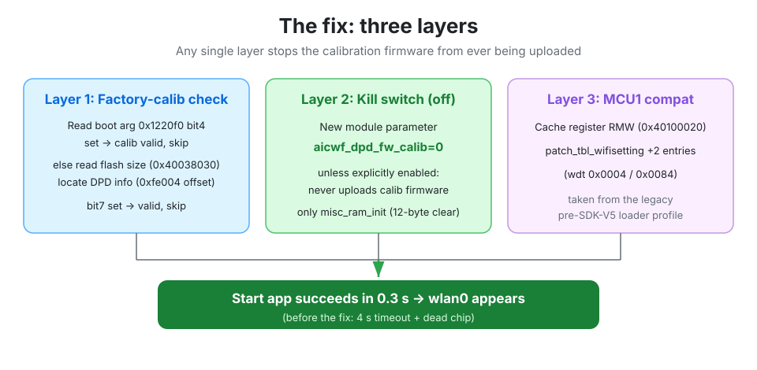
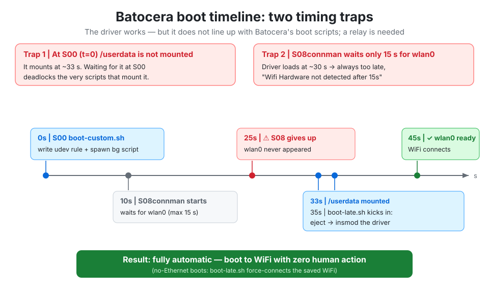
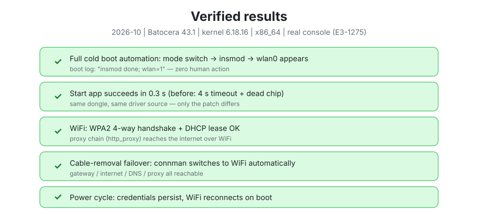

# AIC8800DC single-interface (2357:0147): unbricked on Linux / Batocera

> A ~$3 USB WiFi dongle (AIC8800DC, USB ID `2357:0147`) that **hard-hangs the
> moment the vendor driver loads** — recoverable only by physically unplugging
> it for 10+ seconds. Completely unusable on read-only distros like Batocera.
>
> This repo: **a verified driver patch + full boot-automation scripts + a
> write-up of every pitfall we hit.**

[中文说明 (Chinese, more detailed)](README.md)

## TL;DR



The hang happens because the driver unconditionally runs the DPD calibration
firmware path (`START_APP` cmd 1037, FNCALL `0x130009`). That path is SDK-V5
territory and does not work on older "MCU1" batch chips (`chip_id=7`,
`chip_mcu_id=1`) — the chip receives an unknown command and dies.

The patch:

1. **Legacy DPD validity check** — read boot args at `0x1220f0`, bit4 set =
   factory calibration valid → skip calibration entirely. Otherwise read flash
   size (`0x40038030`) and pick the DPD info base (`0x15→0x4100000`,
   `0x16→0x4300000`, `0x18→0x4700000`) + offset `0xfe004`, bit7 = valid.
2. **`aicwf_dpd_fw_calib` module param (default 0)** — never upload calibration
   firmware unless explicitly enabled; only run `aicwf_misc_ram_init`.
3. **`patch_tbl_wifisetting` additions** — two legacy register entries.
4. **MCU1 cache quirk** — read-modify-write `0x40100020` bit0 during system
   config.
5. USB ID table + chipmatch entries for `2357:0147`.

After the fix: `Start app` succeeds in ~0.3 s and `wlan0` appears.



## Repo layout

| Path | What |
|---|---|
| `patch/aic8800dc-mcu1-support.patch` | unified diff against [ronnyf/AIC8800-Linux-Driver](https://github.com/ronnyf/AIC8800-Linux-Driver) (`patch -p1`) |
| `patched-files/` | the three ready-to-drop-in source files |
| `batocera/` | boot-custom.sh / boot-late.sh / connman-watchdog.sh / 99-aic-eject.rules |
| `build/build-notes.md` | kernel-tree / defconfig / hosttools recipe |

## Usage

```bash
git clone https://github.com/ronnyf/AIC8800-Linux-Driver
cd AIC8800-Linux-Driver
patch -p1 < /path/to/aic8800dc-mcu1-support.patch
```

Build with a kernel tree configured **with your target machine's defconfig**
(otherwise `struct module` layout mismatch → `Number of configurations: 0`).
See [build/build-notes.md](build/build-notes.md).

```bash
insmod aic_load_fw.ko  aic_fw_path=/path/to/fw
insmod aic8800_fdrv.ko aic_fw_path=/path/to/fw
```

## Batocera specifics



1. **`/userdata` mounts ~33 s after boot** (S02/S04), while `boot-custom.sh`
   runs at S00 — waiting for it there deadlocks the boot. Do `/userdata` work
   in a background script that polls for the mount.
2. **Batocera's `S08connman` only waits 15 s for a wlan interface** and gives
   up — our driver loads at ~30 s, so `boot-late.sh` redoes
   `rfkill unblock wifi` + `connmanctl enable wifi` (plus a forced
   `connmanctl connect` when booting with no Ethernet).
3. **`SingleConnectedTechnology=true`**: connman intentionally will not
   connect WiFi while Ethernet is up. When Ethernet drops, connmand may
   SIGSEGV during the handover → `connman-watchdog.sh` restarts it every 20 s.
4. WiFi credentials persist via `/userdata/system/batocera.conf`
   (`wifi.ssid` / `wifi.key`).

## Verified (Batocera 43.1, kernel 6.18.16, x86_64)



- ✅ Full cold boot automation (`insmod done; wlan=1` in boot log)
- ✅ `Start app` 0.3 s (was: 4 s timeout + brick)
- ✅ WPA2 handshake + DHCP
- ✅ Cable-removal failover to WiFi (gateway/internet/DNS/proxy all reachable)
- ✅ Credentials survive power cycle

## Known limitations

- Targets the `2357:0147` / MCU1 batch only; D80 / MCU2 chips don't need it.
- DPD calibration is skipped by default (no observed impact; legacy validity
  check still reports `valid_out=1` on chips with factory calibration).
- Occasional connman crash on Ethernet→WiFi handover is mitigated, not fixed.

## Credits

- Upstream driver: [ronnyf/AIC8800-Linux-Driver](https://github.com/ronnyf/AIC8800-Linux-Driver)
- Legacy MCU1 reference: [shenmintao/aic8800d80](https://github.com/shenmintao/aic8800d80)
- License: GPL-2.0
