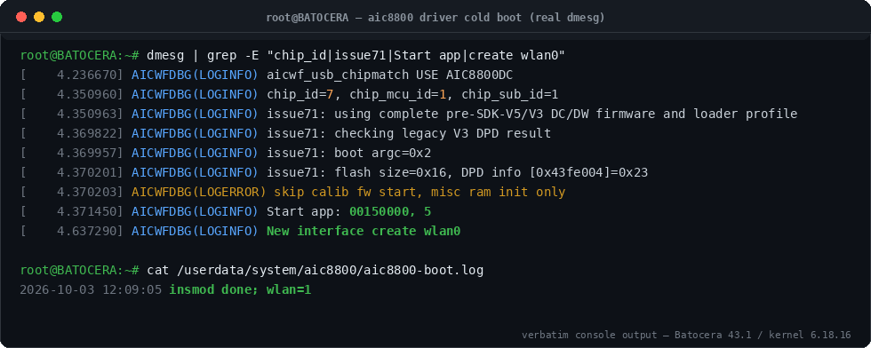
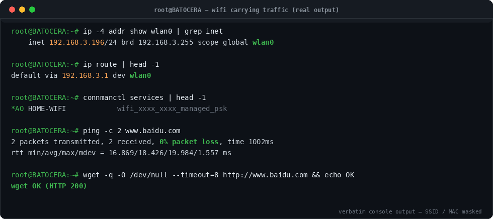
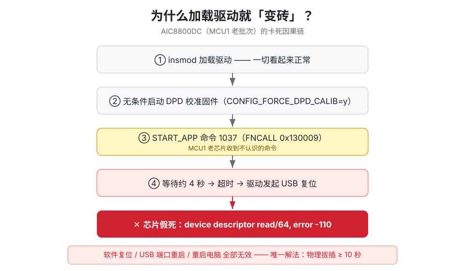
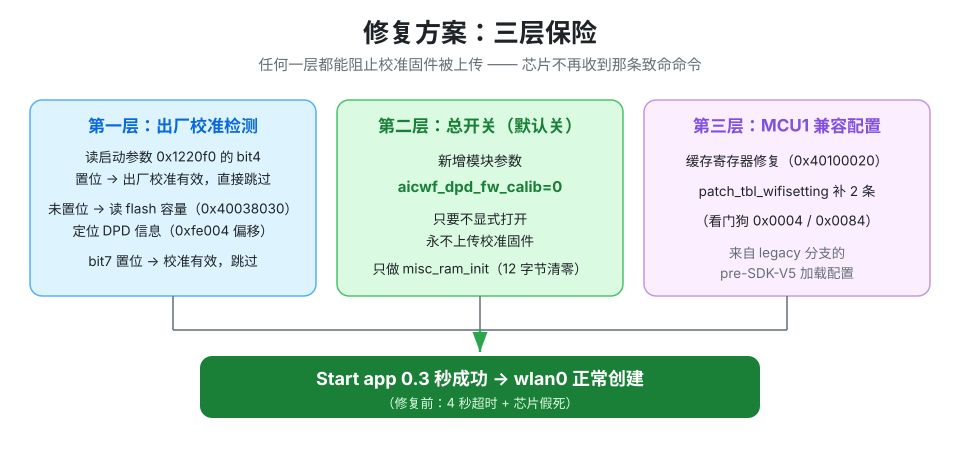
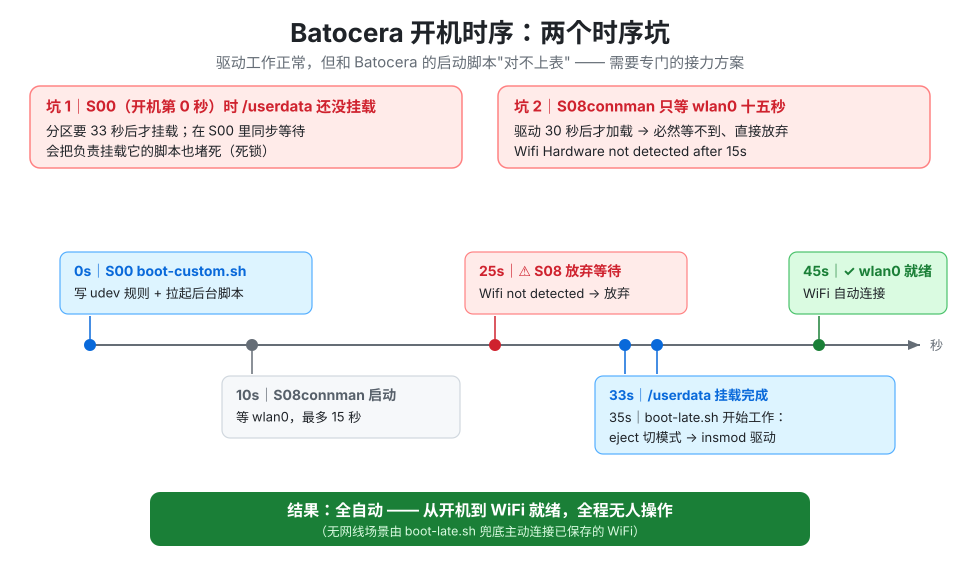
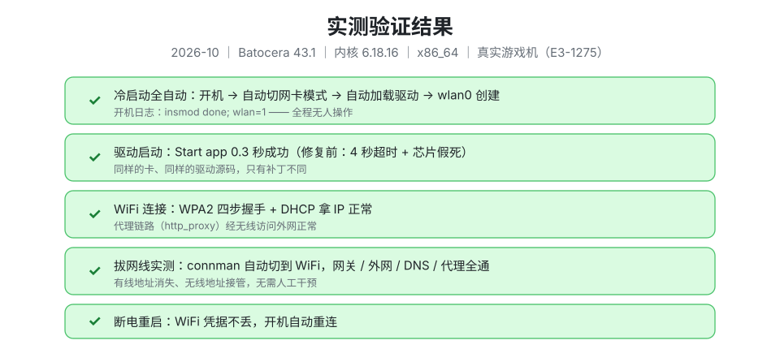

# AIC8800DC 无线网卡驱动（USB 2357:0147）：Linux / Batocera 免砖移植

[](https://github.com/metahubaifeel/aic8800dc-batocera/releases)
[](LICENSE)

> 一块二十来块的 USB WiFi 网卡（AIC8800DC 芯片，USB ID `2357:0147`），
> 用官方驱动加载会**当场假死变砖**（只能拔下来断电十秒才能救活），
> 在 Batocera 这类只读系统上更是完全没法用。
>
> 本仓库提供：**验证过可用的驱动补丁 + 全套开机自动化脚本 + 一份完整的踩坑记录**。

> English version → [README.en.md](README.en.md)

---

## 实机效果（真实截图，非示意图）


*真实游戏机（Batocera 43.1）跑起来的样子——画面里这台机器此刻正靠 AIC8800DC 无线上网，网线已拔。*



*真机 `dmesg`：识别出老批次（`chip_id=7, chip_mcu_id=1`）→ 走 legacy 流程 → 跳过校准固件 → **0.3 秒 `Start app` 成功** → `wlan0` 创建。开机日志 `insmod done; wlan=1`，全程无人操作。*



*真机网络状态：DHCP 拿到 `192.168.3.196`，默认路由走 `wlan0`，ping 外网 0% 丢包、HTTP 200。（SSID / MAC 已打码）*

---

## 1. 背景：这卡有什么特别的

AIC8800DC 是 AICSemi 的一款 USB WiFi 芯片，TP-Link、水星（MERCURY）等品牌都有贴牌产品。它有两个"人格"：

1. **插上电脑先装成 U 盘**（`a69c:5721`），里面放一个 Windows 驱动 exe；
2. **`eject` 一次**（或驱动/udev 规则触发）→ USB 重新枚举成真正的网卡（`2357:0147`）。

关键差异在于**批次**。本仓库针对的是这类卡里的"老批次"：

| 属性 | 值 | 说明 |
|---|---|---|
| USB ID | `2357:0147` | 单配置、单接口 |
| chip_id | `0x7` | AIC8800DC |
| chip_mcu_id | `0x1` | **MCU1，老批次**，走 legacy 加载流程 |
| 接口数 | 1 | 驱动内部会打印 `AIC8800DC change to AIC8800DW`（厂商设计行为，正常） |

主流的 AIC8800D80 / DC 新批次（MCU2+）用上游驱动开箱即用；**MCU1 老批次不行**——这就是本仓库存在的理由。

## 2. 三个坑（按踩到的顺序）

### 坑 1：驱动根本不认这张卡

上游 `ronnyf/AIC8800-Linux-Driver` 的 USB ID 表里没有 `2357:0147`（有 `014b` 水星、`014e`、`014f`，偏偏没有 `0147`）。

**修复**：ID 表加一行 + `chipmatch` 加一个判断。5 分钟的事——如果只有这一个坑，这仓库就不用建了。

### 坑 2：加载即变砖（本仓库的核心）



**现象**：`insmod` 后驱动日志一路正常，直到：

```
Start app: 00130009, FNCALL        <- 启动 DPD 校准固件（命令 1037）
```

然后**等大约 4 秒，超时**，驱动做 USB 复位，芯片彻底无响应：

```
usb 1-1.2: device descriptor read/64, error -110
```

此后：`lsusb` 看不到它、USB 端口 disable/enable 没用、`usbdevfs reset` 没用、**重启电脑也没用**。芯片进入了真正的假死状态。

**唯一解法：物理拔下来，断电 ≥ 10 秒**（或在别的 USB 口上插一次再拔）。

**根因**：驱动默认配置 `CONFIG_DPD=y + CONFIG_FORCE_DPD_CALIB=y`，冷启动时无条件跑 DPD（数字预失真）校准流程 —— 但对 MCU1 老批次，这条"上传校准固件 → FNCALL 启动"的 SDK-V5 路径根本不适用，芯片收到不认识的命令直接挂死。

**修复**（三层保险）：

1. **DPD 有效性检测改为 legacy 版本**：先读启动参数 `0x1220f0` 的 bit4 —— 置位表示出厂校准结果有效，直接跳过校准；没置位则读 flash 容量（`0x40038030`），按容量选基址（`0x15→0x4100000`、`0x16→0x4300000`、`0x18→0x4700000`）再读 `0xfe004` 偏移处的 DPD 信息，bit7 = 有效。
2. **`aicwf_dpd_fw_calib` 模块参数（默认 0 = 关）**：只要没显式打开，驱动**永不上传校准固件**，只做 `aicwf_misc_ram_init`（清 12 字节 misc ram）。实测这一步就足够让芯片正常启动。
3. **`patch_tbl_wifisetting` 补两条寄存器配置**（`{0x0004, 0x00020010}` 看门狗、`{0x0084, 0x00000040}`），来自 legacy 分支。

修好后实测：**0.3 秒内 `Start app` 成功，`wlan0` 正常创建**。



### 坑 3：MCU1 的缓存配置缺失

legacy 流程在系统配置阶段需要读-改-写一个缓存控制寄存器（`0x40100020`，置 bit0），上游代码只在部分分支里有。补上后芯片启动更稳。

## 3. 补丁一览

补丁文件： [`patch/aic8800dc-mcu1-support.patch`](patch/aic8800dc-mcu1-support.patch)（unified diff，`-p1` 可用），也可从 [Releases](https://github.com/metahubaifeel/aic8800dc-batocera/releases) 直接下载
改好的完整文件： [`patched-files/`](patched-files/)（直接覆盖同名文件即可）

| 文件 | 改动 | 作用 |
|---|---|---|
| `aicwf_usb.h` | 加 `USB_PRODUCT_ID_TP_8800DC 0x0147` | 识别这张卡 |
| `aicwf_usb.c` | ID 表加条目；`chipmatch` 加 `\|\| pid == ...0147` | 识别这张卡 |
| `aicwf_compat_8800dc.c` | `patch_tbl_wifisetting` 加 2 条 | legacy 寄存器配置 |
| 同上 | `aicwf_misc_ram_valid_check_8800dc` 加 legacy DPD 检测 | 避免误判"校准无效" |
| 同上 | 新增 `aicwf_dpd_fw_calib` 参数（默认 0） | **防变砖总开关** |
| 同上 | `system_config_8800dc` 加 MCU1 缓存读改写 | 老芯片启动稳定性 |
| 同上 | 日志增强（打印 chip_mcu_id） | 排障友好 |

## 4. 怎么用

### 方式 A（推荐）：打补丁

```bash
git clone https://github.com/ronnyf/AIC8800-Linux-Driver   # 或你自己的 fork
cd AIC8800-Linux-Driver
patch -p1 < /path/to/aic8800dc-mcu1-support.patch
```

### 方式 B：覆盖文件

把 [`patched-files/`](patched-files/) 里的三个文件覆盖到
`drivers/aic8800/aic8800_fdrv/` 下同名文件。

### 编译（重点：内核树必须匹配目标机）

```bash
# 在内核源码树里（版本 = 目标机 uname -r）
make defconfig        # 如果是 Batocera：必须换成它的官方 defconfig！见下
make modules_prepare

cd drivers/aic8800
make KDIR=/path/to/kernel/tree -j$(nproc)
```

两个大坑：

1. **defconfig 必须和目标机一致**。用发行版通用配置编出来的模块，`struct module` 布局对不上，加载时报 `Number of configurations: 0` 之类的怪错。Batocera 的内核源码树带官方 defconfig（`linux_x86_64-defconfig.config`），务必用它。
2. **`modules_prepare` 需要完整工具链**：`objtool`、`libelf`、`libzstd`、`bison`、`m4`。缺啥补啥，`PKG_CONFIG_PATH` 指向自备的 hosttools 即可（见 [`build/build-notes.md`](build/build-notes.md)）。

编完核对 vermagic 与目标机 `uname -r` 一致：

```bash
strings aic8800_fdrv.ko | grep vermagic
```

### 加载

```bash
insmod aic_load_fw.ko  aic_fw_path=/path/to/fw     # 固件目录，内含 aic8800DC/*.bin
insmod aic8800_fdrv.ko aic_fw_path=/path/to/fw
# 排障加 aicwf_dbg_level=3（1=ERROR 2=INFO 4=TRACE）
```

## 5. Batocera 集成（开箱脚本）

[`batocera/`](batocera/) 里的脚本是**在 Batocera 43.1 上实测跑通**的完整方案：

| 文件 | 作用 |
|---|---|
| `boot-custom.sh` | 官方的开机钩子（S00 最早执行）：写 udev 规则 + 把重活丢后台 |
| `boot-late.sh` | 等 `/userdata` 挂载 → 弹 U 盘模式 → `insmod` → 解锁 rfkill → 兜底连 WiFi |
| `connman-watchdog.sh` | connman 崩溃自愈（见下面第 3 条） |
| `99-aic-eject.rules` | udev 规则：看到 `a69c:5721` 自动 `eject` 切成网卡模式 |

### Batocera 特有的三个时序坑



1. **`/userdata` 到开机约 33 秒才挂载**（S02/S04 才挂），而 `boot-custom.sh` 在 S00（最早）执行时根本看不到它。**在 S00 里同步等 `/userdata` 会死锁**（把挂载脚本自己也堵住了）。正确姿势：所有依赖 `/userdata` 的工作丢进后台脚本轮询等待。
2. **Batocera 的 `S08connman` 只等无线网卡 15 秒**，等不到就放弃（"Wifi Hardware not detected after 15s. Aborting."）。我们的驱动 30 秒后才加载，**必然错过**。所以 `boot-late.sh` 里要补 `rfkill unblock wifi` + `connmanctl enable wifi`（无网线场景再补一次主动 `connmanctl connect`）。
3. **`SingleConnectedTechnology=true`**（`/etc/connman/main.conf`）：有线在线时 connman **故意不连 WiFi** —— 这是设计不是 bug。但我们的实测中，**有线掉线、WiFi 接管的瞬间 connmand 可能段错误**（WiFi 链路本身不受影响，但面板管理失效）→ 用 `connman-watchdog.sh` 每 20 秒拉起。

### WiFi 密码持久化

Batocera 根目录是 tmpfs，重启即清空。密码要写在 `/userdata/system/batocera.conf`：

```
wifi.enabled=1
wifi.ssid=你的WiFi名
wifi.key=你的密码
```

`S08connman` 每次开机读它生成 connman 配置，断电不丢。

### 部署步骤

```bash
# 游戏机上（root）
mkdir -p /userdata/system/aic8800/{modules,fw}
# 放入：aic_load_fw.ko、aic8800_fdrv.ko、固件目录（aic8800DC/*.bin）
# 放入脚本，touch 自启标记：
cp boot-late.sh connman-watchdog.sh /userdata/system/aic8800/
chmod +x /userdata/system/aic8800/*.sh
touch /userdata/system/aic8800/enable-autostart
# 把 boot-custom.sh 放到 /boot/（Batocera 官方开机钩子，注意先 mount -o remount,rw /boot）
```

`boot-custom.sh` 与 `boot-late.sh` 的路径常量（`AIC_DIR` 等）按需改。

## 6. 验证结果（2026-10，Batocera 43.1 / kernel 6.18.16 / x86_64）



- ✅ 冷启动全自动：开机 → 自动弹 U 盘模式 → 自动 `insmod` → `wlan0` 创建（开机日志 `insmod done; wlan=1`）
- ✅ 手动加载：`Start app` 0.3 秒成功（修复前是 4 秒超时 + 变砖）
- ✅ WiFi 连接：WPA2 四步握手 + DHCP 正常
- ✅ **拔网线实测**：connman 自动切到 WiFi，网关/外网/DNS/代理全通（且这次没触发 connman 崩溃）
- ✅ 断电重启：WiFi 凭据不丢，自动重连

## 7. 已知问题

- **上游未合并**：本补丁基于 `ronnyf/AIC8800-Linux-Driver`（v6.4.3.0-ronnyf），并已[向上游提交 issue #32](https://github.com/ronnyf/AIC8800-Linux-Driver/issues/32) 提议合并。上游代码在动，patch 可能不直接 apply，`patched-files/` 里的完整文件以对应版本为准。
- **DPD 校准被跳过**：`aicwf_dpd_fw_calib=0` 意味着不做出厂校准。实测日常使用（连接、速率、稳定度）无感知差异；如果你的卡校准数据本来就有效（boot-arg bit4 置位），legacy 检测会自动识别并将 `valid_out=1`，行为与正常一致。
- connman 接管瞬间的偶发段错误未根治（看门狗兜底）。
- 只测了 `2357:0147` 这一个 ID / MCU1 批次；MCU2 及 D80 不需要本补丁。

## 8. 常见问题（FAQ）

**Q：这块卡插上电脑，只出现一个 U 盘、没有 WiFi，正常吗？**
正常，这是出厂设计。AIC8800DC 默认是"U 盘模式"（`a69c:5721`），里面装着 Windows 驱动；`eject` 一次它就会重新枚举成真正的网卡（`2357:0147`）。Linux 下用本仓库的 udev 规则可以自动完成。

**Q：加载驱动后网卡突然消失，`lsusb` 也看不到，换 USB 口、重启电脑都没用——是坏了吗？**
没坏，是芯片进入了假死状态（本仓库说的"变砖"）。**唯一解法是物理拔下来、断电 10 秒以上**（插到别的 USB 口一次也行）。原因与修复见[坑 2](#坑-2加载即变砖本仓库的核心)。

**Q：AIC8800D80、或者新批次的 AIC8800DC 需要打这个补丁吗？**
不需要。补丁只针对老批次 MCU1（`chip_id=7`、`chip_mcu_id=1`、USB ID `2357:0147`）；D80 和新批次（MCU2+）用上游驱动就能正常工作。

**Q：Batocera 里 WiFi 密码都填了，为什么开机不自动连？**
两个原因：Batocera 的 `S08connman` 只等无线网卡 15 秒（本驱动约 30 秒才加载完，必然错过）；且 `SingleConnectedTechnology=true` 时插着网线 connman 会故意不连 WiFi。用本仓库的 `boot-late.sh` 解决，详见[第 5 节](#5-batocera-集成开箱脚本)。

**Q：跳过了 DPD 校准，会不会影响网速和稳定性？**
实测无感知差异。而且如果这张卡的出厂校准数据有效，legacy 检测会自动识别并照常走正常路径（`valid_out=1`）。

**Q：为什么不用官方驱动？会合并进上游吗？**
官方驱动就是上游（`ronnyf/AIC8800-Linux-Driver`），本补丁正是打在它上面的。上游暂未包含 MCU1 老批次支持；合并前用本仓库的 patch 或 `patched-files/` 覆盖即可。

## 9. 参考

- 上游驱动：[ronnyf/AIC8800-Linux-Driver](https://github.com/ronnyf/AIC8800-Linux-Driver)
- Legacy MCU1 实现参考：[shenmintao/aic8800d80](https://github.com/shenmintao/aic8800d80)（legacy-mcu1 分支）
- DPD / 卡死相关上游 issue：#31 等
- Batocera：<https://batocera.org>

## License

GPL-2.0（与上游驱动一致）。补丁与脚本文档同许可，随意使用。
